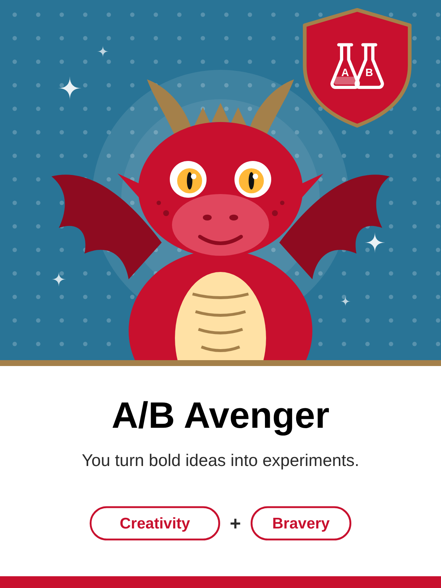
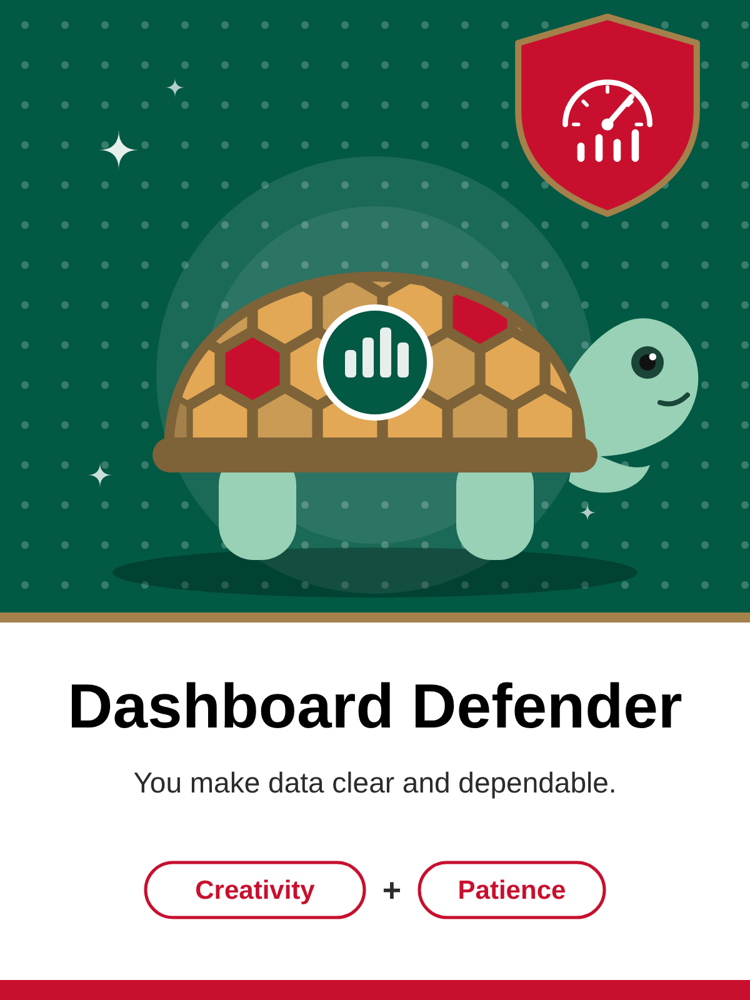
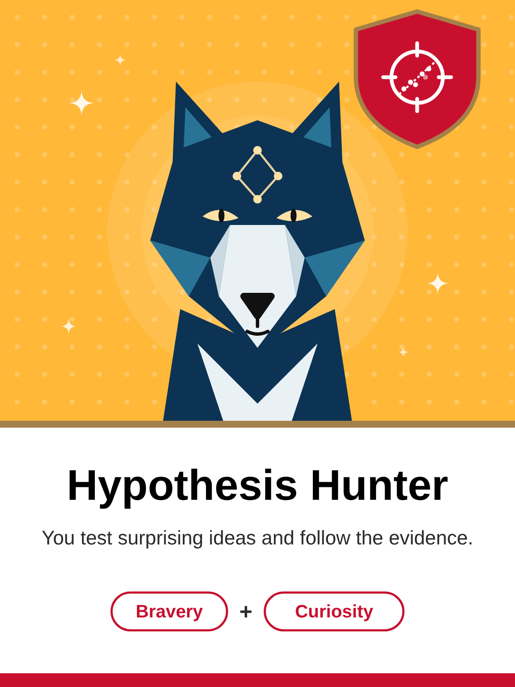
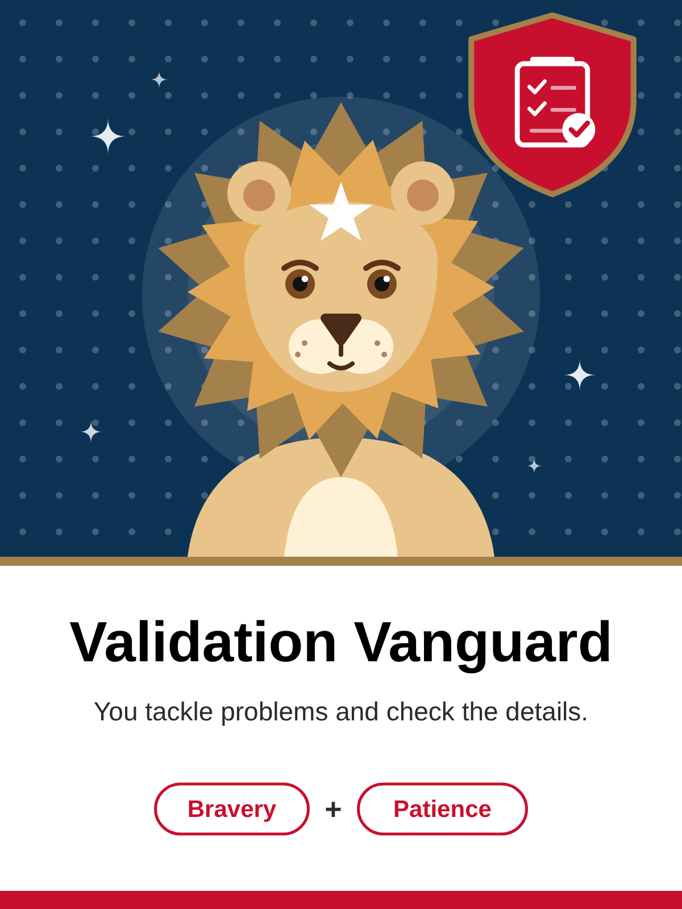

# 🦸 Data Science Superpower Lab

A short, just-for-fun [Streamlit](https://streamlit.io) quiz. Rate yourself on four strengths, answer two questions, and find out which of six data science superheroes you are.

<p align="center">
  
</p>

---

## Contents

- [The heroes](#the-heroes)
- [Quick start](#quick-start)
- [User guide](#user-guide)
- [Widgets used](#widgets-used)
- [Technical documentation](#technical-documentation)
- [Project structure](#project-structure)
- [Further reading](#further-reading)

---

## The heroes

Your **two highest-scoring strengths** decide your hero:

| | | |
|:---:|:---:|:---:|
| <br>**A/B Avenger**<br>Bravery + Creativity | <br>**Visualisation Visionary**<br>Creativity + Curiosity | <br>**Dashboard Defender**<br>Creativity + Patience |
| <br>**Hypothesis Hunter**<br>Bravery + Curiosity | <br>**Validation Vanguard**<br>Bravery + Patience | <br>**Pattern Detective**<br>Curiosity + Patience |

---

## Quick start

Requires Python 3.9+.

```bash
pip install -r requirements.txt
streamlit run app.py
```

The app opens in your browser at <http://localhost:8501>.

---

## User guide

1. **Enter your name** (optional). It is shown on your result card with each word capitalised. If you leave it blank you are called "Hero".
2. **Move the four sliders** (🎨 Creativity, ⚡ Bravery, 🔎 Curiosity, 🧩 Patience) to rate yourself from 0 to 10. Each starts at 5.
3. **Pick the strength you use most** from the drop-down. That strength gets **+3 bonus points**.
4. **Pick the strength your friends would choose for you** with the radio buttons. That strength gets **+2 bonus points**.
5. Click **Reveal my superhero!** Your hero card appears below the form.

Nothing happens while you change the answers. The quiz is inside a form, so it only scores when you press the button. Change any answer and press it again to try another combination.

### Worked example

| Strength | Slider | Drop-down bonus | Radio bonus | **Total** |
|---|:---:|:---:|:---:|:---:|
| Creativity | 6 | | | **6** |
| Bravery | 4 | | +2 | **6** |
| Curiosity | 8 | +3 | | **11** |
| Patience | 5 | | | **5** |

The top two are Curiosity (11) and Creativity (6). Bravery also has 6, but it loses the tie because Creativity comes first in the list (see [Tie-breaking](#tie-breaking)). Creativity + Curiosity gives the **Visualisation Visionary**.

> The results are just for fun and are not a real personality test.

---

## Widgets used

Every Streamlit command in [app.py](app.py), in the order it appears:

| # | Command | Type | What it does in this app | Key arguments | Returns | Docs |
|:-:|---|---|---|---|---|---|
| 1 | `st.set_page_config` | Configuration | Sets the browser-tab title and the 🦸 favicon | `page_title`, `page_icon` | — | [docs](https://docs.streamlit.io/develop/api-reference/configuration/st.set_page_config) |
| 2 | `st.html` | Utility | Injects [style.css](style.css) into the page | a `Path` to the CSS file | — | [docs](https://docs.streamlit.io/develop/api-reference/utilities/st.html) |
| 3 | `st.title` | Text | Page heading "🦸 Data Science Superpower Lab" | heading text | — | [docs](https://docs.streamlit.io/develop/api-reference/text/st.title) |
| 4 | `st.write` | Text | Tagline "Find your statistics superhero!" | text | — | [docs](https://docs.streamlit.io/develop/api-reference/write-magic/st.write) |
| 5 | `st.form` | Layout / execution flow | Groups all inputs so the app only reruns when the button is pressed | key `"quiz"` | form container | [docs](https://docs.streamlit.io/develop/api-reference/execution-flow/st.form) |
| 6 | `st.text_input` | Input widget | Asks for the user's name | label | `str` (then `.title()`) | [docs](https://docs.streamlit.io/develop/api-reference/widgets/st.text_input) |
| 7 | `st.slider` ×4 | Input widget | Rates Creativity, Bravery, Curiosity and Patience | `min=0`, `max=10`, `value=5` | `int` | [docs](https://docs.streamlit.io/develop/api-reference/widgets/st.slider) |
| 8 | `st.selectbox` | Input widget | "Which strength do you use most?" (**+3**) | 4 strength options | `str` | [docs](https://docs.streamlit.io/develop/api-reference/widgets/st.selectbox) |
| 9 | `st.radio` | Input widget | "Which strength would your friends pick for you?" (**+2**) | 4 strength options | `str` | [docs](https://docs.streamlit.io/develop/api-reference/widgets/st.radio) |
| 10 | `st.form_submit_button` | Button | "Reveal my superhero!" Submits the form | label | `bool` | [docs](https://docs.streamlit.io/develop/api-reference/execution-flow/st.form_submit_button) |
| 11 | `st.container` | Layout | The result card. `key="hero_card"` adds the CSS class `.st-key-hero_card` | `key` | container | [docs](https://docs.streamlit.io/develop/api-reference/layout/st.container) |
| 12 | `st.subheader` | Text | "🦸 *Name*, you are the *Hero*!" | heading text | — | [docs](https://docs.streamlit.io/develop/api-reference/text/st.subheader) |
| 13 | `st.image` | Media | Shows the hero picture | file path, `width=340` | — | [docs](https://docs.streamlit.io/develop/api-reference/media/st.image) |

---

## Technical documentation

### How it works

```text
form inputs ──► scores dict ──► +3 selectbox, +2 radio ──► top 2 strengths ──► sort A–Z ──► HEROES lookup ──► card
```

1. **Inputs.** The four sliders fill a `scores` dictionary: `{"Creativity": …, "Bravery": …, "Curiosity": …, "Patience": …}`.
2. **Bonuses.** `scores[mission] += 3` (selectbox) and `scores[style] += 2` (radio). If both pick the same strength, it gets +5.
3. **Top two.** `sorted(scores, key=scores.get, reverse=True)[:2]` returns the two strengths with the highest scores.
4. **Lookup key.** The pair is sorted alphabetically and joined with `" + "`, e.g. `"Creativity + Curiosity"`, so the order of the two scores does not matter.
5. **Result.** The key looks up `(hero name, image path)` in the `HEROES` dictionary. Four strengths give 4C2 = **6** pairs, one per hero, so every combination has a match.

Scores range from 0 to 15 (slider 10 + 3 + 2).

### Tie-breaking

Python's `sorted` is stable. When two strengths have the same score, the one that comes first in the `scores` dictionary wins: **Creativity → Bravery → Curiosity → Patience**. For example, if you submit without changing anything (all sliders at 5, both bonuses on Creativity), the scores are Creativity 10 and the rest 5, so Bravery takes second place and you get the **A/B Avenger**.

### Styling ([style.css](style.css))

CSS is loaded with `st.html(Path("style.css"))`. It uses only stable selectors:

- `data-testid` attributes, such as `stApp`, `stForm`, `stSlider`, `stRadio`, `stFormSubmitButton` and `stImage`
- `st-key-*` classes, such as `.st-key-hero_card`, created by `st.container(key=...)`

Generated classes like `.st-emotion-cache-…` are avoided because they change between Streamlit releases.

Colours are defined once as CSS custom properties on `:root`:

| Group | Variables |
|---|---|
| Orange | `--peach-light` `#faae80`, `--orange` `#f58552`, `--orange-dark` `#d74b19` |
| Yellow | `--cream` `#ffe1a5`, `--sun` `#fec54c` |
| Green | `--mint-light` `#bfe2c6`, `--sage` `#609f80`, `--forest` `#045944` |
| Blue | `--sky-light` `#c8eaf7`, `--sky` `#62b6d0`, `--ocean` `#2d7496`, `--navy` `#0d3353` |

Other styling: the Streamlit header is hidden, the page has a sky-to-cream gradient, the content sits in a white rounded card with an orange top border, sliders have orange handles, and the hero card centres a rounded image with a shadow.

### Assets

Each hero has a `.png` (1200×1600, used by the app) and a `.svg` source in [assets/](assets/). `all_heroes_preview.png` (1800×1600) is the combined preview used at the top of this README.

### Extending the app

- **Add or rename a hero:** edit the `HEROES` dictionary. Keys must be two strength names in A–Z order joined by `" + "`.
- **Add a fifth strength:** add a slider, add the name to the selectbox and radio options and to `scores`, then add a hero for each new pair (5 strengths = 10 pairs).
- **Change the bonuses:** edit the `+= 3` and `+= 2` lines.

### Debug output

`app.py` contains three `print()` calls that write the scores and top two to the terminal running `streamlit run`. They are not shown in the browser and can be removed.

---

## Project structure

```text
superpower_personality_lab/
├── app.py              # Streamlit app: quiz, scoring and result card
├── style.css           # Custom theme and layout styles
├── requirements.txt    # Dependencies (streamlit)
├── README.md
└── assets/
    ├── all_heroes_preview.png
    ├── ab_avenger.png / .svg
    ├── dashboard_defender.png / .svg
    ├── hypothesis_hunter.png / .svg
    ├── pattern_detective.png / .svg
    ├── validation_vanguard.png / .svg
    └── visualisation_visionary.png / .svg
```

---

## Further reading

- [Streamlit documentation](https://docs.streamlit.io)
- [Streamlit API reference](https://docs.streamlit.io/develop/api-reference)
- [Get started with Streamlit](https://docs.streamlit.io/get-started)
- [Using forms](https://docs.streamlit.io/develop/concepts/architecture/forms)
- [Widget behaviour](https://docs.streamlit.io/develop/concepts/architecture/widget-behavior)
- [Deploy to Streamlit Community Cloud](https://docs.streamlit.io/deploy/streamlit-community-cloud)
- [Python `sorted()`](https://docs.python.org/3/library/functions.html#sorted)
