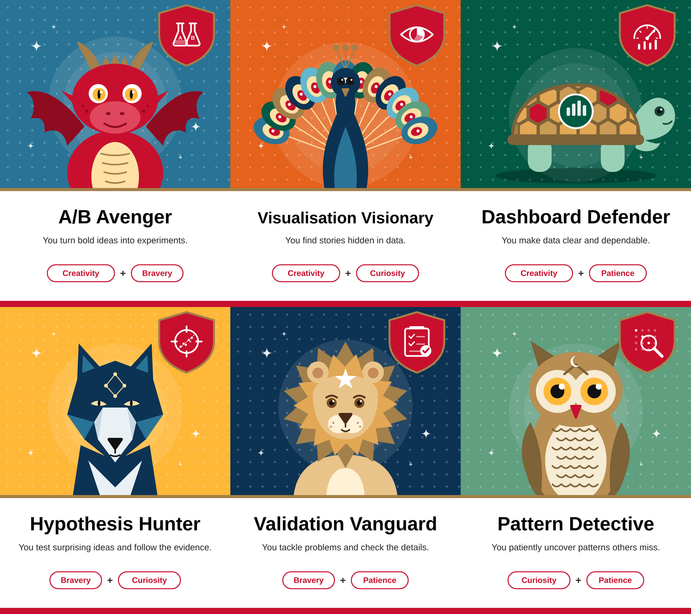
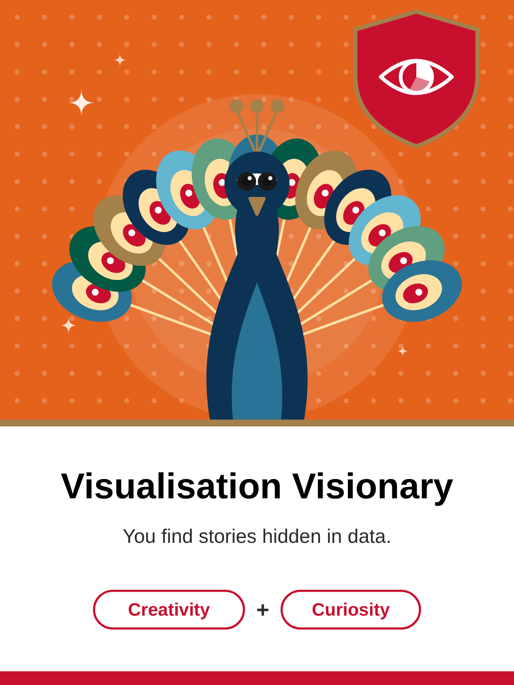
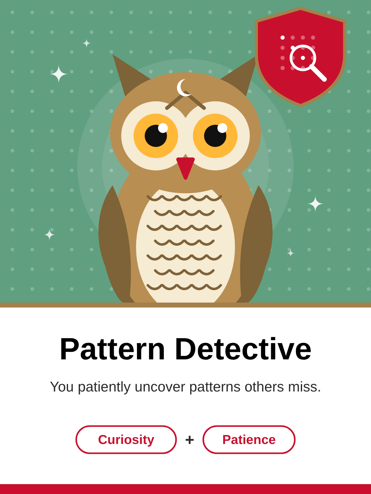

# Data Science Superpower Lab

The Data Science Superpower Lab is a short quiz built with Streamlit. The user rates four strengths, answers two questions and is matched to one of six data science superheroes. Figure 1 shows all six heroes together. The results are for fun only and are not a real personality test.

<em>Figure 1. The six superheroes.</em>

## User Guide

To run the app, install the requirements with `pip install -r requirements.txt` and start it with `streamlit run app.py`. The quiz opens in the browser at `http://localhost:8501`.

The user first types their name, which is optional. They then use four sliders to rate Creativity, Bravery, Curiosity and Patience from 0 to 10. Next, they choose the strength they use most from a drop-down list, which adds 3 points, and the strength their friends would pick from a set of radio buttons, which adds 2 points. Pressing "Reveal my superhero!" shows the result card. Because the questions sit inside a form, nothing is scored until the button is pressed.

The two highest-scoring strengths decide the hero. Bravery and Creativity give the A/B Avenger (Figure 2). Creativity and Curiosity give the Visualisation Visionary (Figure 3). Creativity and Patience give the Dashboard Defender (Figure 4). Bravery and Curiosity give the Hypothesis Hunter (Figure 5). Bravery and Patience give the Validation Vanguard (Figure 6). Curiosity and Patience give the Pattern Detective (Figure 7).

<em>Figure 2. A/B Avenger. Figure 3. Visualisation Visionary. Figure 4. Dashboard Defender.</em>

<em>Figure 5. Hypothesis Hunter. Figure 6. Validation Vanguard. Figure 7. Pattern Detective.</em>

## Technical Documentation

The app has three main files. `app.py` holds the quiz and the scoring, `style.css` holds the custom styling, and `requirements.txt` lists the only dependency, Streamlit. The hero images are stored in the `assets` folder as PNG files, with SVG source files alongside them.

When the form is submitted, the four slider values are stored in a dictionary. The drop-down choice adds 3 points and the radio choice adds 2 points, so each strength can score between 0 and 15. The two highest strengths are put in alphabetical order and joined into a key such as "Creativity + Curiosity", which is used to look up the hero name and image. Four strengths make six possible pairs, so every result matches one hero. If two strengths have the same score, the one that comes first in the order Creativity, Bravery, Curiosity, Patience is chosen, because Python's `sorted` function keeps the original order for ties.

The styling is loaded with `st.html`. It targets Streamlit's `data-testid` attributes and the `st-key-hero_card` class, because these stay the same between Streamlit versions. The colours are stored once as CSS variables so that they are easy to change.

Table 1 lists the Streamlit widgets and commands used in the app, with a link to the official documentation for each.

*Table 1. Streamlit widgets and commands used in `app.py`.*

| Command | Type | Purpose in the app | Documentation |
| --- | --- | --- | --- |
| `st.set_page_config` | Configuration | Sets the browser tab title and icon | [st.set_page_config](https://docs.streamlit.io/develop/api-reference/configuration/st.set_page_config) |
| `st.html` | Utility | Loads the CSS file | [st.html](https://docs.streamlit.io/develop/api-reference/utilities/st.html) |
| `st.title` | Text | Shows the page title | [st.title](https://docs.streamlit.io/develop/api-reference/text/st.title) |
| `st.write` | Text | Shows the short introduction | [st.write](https://docs.streamlit.io/develop/api-reference/write-magic/st.write) |
| `st.form` | Execution flow | Groups the questions so they are scored together | [st.form](https://docs.streamlit.io/develop/api-reference/execution-flow/st.form) |
| `st.text_input` | Input widget | Asks for the user's name | [st.text_input](https://docs.streamlit.io/develop/api-reference/widgets/st.text_input) |
| `st.slider` | Input widget | Rates each of the four strengths from 0 to 10 | [st.slider](https://docs.streamlit.io/develop/api-reference/widgets/st.slider) |
| `st.selectbox` | Input widget | Picks the strength used most (+3 points) | [st.selectbox](https://docs.streamlit.io/develop/api-reference/widgets/st.selectbox) |
| `st.radio` | Input widget | Picks the strength friends would choose (+2 points) | [st.radio](https://docs.streamlit.io/develop/api-reference/widgets/st.radio) |
| `st.form_submit_button` | Input widget | Submits the form | [st.form_submit_button](https://docs.streamlit.io/develop/api-reference/execution-flow/st.form_submit_button) |
| `st.container` | Layout | Holds the result card | [st.container](https://docs.streamlit.io/develop/api-reference/layout/st.container) |
| `st.subheader` | Text | Shows the hero name on the card | [st.subheader](https://docs.streamlit.io/develop/api-reference/text/st.subheader) |
| `st.image` | Media | Shows the hero picture | [st.image](https://docs.streamlit.io/develop/api-reference/media/st.image) |

More information is available in the [Streamlit documentation](https://docs.streamlit.io).
